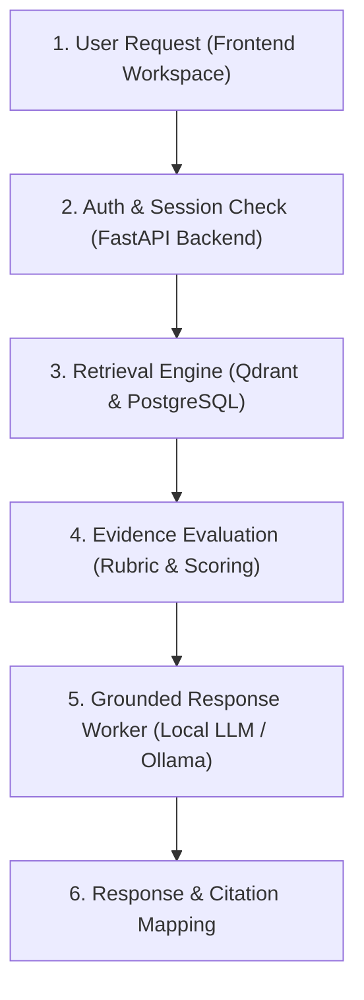

# CAPONE-71: Thiết kế kiến trúc và danh mục Test Cases tính năng Simple Ask

- Người phụ trách: Kiều Đức Chung.
- Technical Task: `S2-CHUNG-05` / `[DOC] Update Simple Ask Architecture & Test Cases`.
- Jira: [CAPONE-71](https://thanhhai2kar5.atlassian.net/browse/CAPONE-71).
- Sprint: Sprint 2.
- Ngày lập: 19/10/2026.
- Trạng thái: `In Progress`.

---

## 1. Tổng quan tính năng Simple Ask trong Sprint 2

Trong phạm vi Sprint 2, tính năng **Simple Ask** đóng vai trò là luồng hỏi đáp RAG cơ bản có đối chiếu bằng chứng (Grounded Q&A), phục vụ người dùng đã đăng nhập tra cứu thông tin trực tiếp từ kho tài liệu của chính mình:
- **Người dùng:** Đặt các câu hỏi kỹ thuật xoay quanh nội dung tài liệu đã tải lên hệ thống.
- **Hệ thống:** Truy xuất các đoạn văn bản (chunks) liên quan nhất, đánh giá mức độ liên quan của bằng chứng (evidence), sinh câu trả lời bám sát nội dung và trích dẫn nguồn (citation) rõ ràng.
- **Cơ chế an toàn (Negative Control):** Trường hợp kho tài liệu không chứa thông tin trả lời, hệ thống nhận diện và phản hồi trạng thái `NO_EVIDENCE` kèm trích dẫn rỗng, ngăn chặn hiện tượng tự suy diễn (hallucination).

Tài liệu này tổng hợp thiết kế kiến trúc luồng xử lý và đặc tả chi tiết bộ 12 Test Cases nghiệm thu, đảm bảo khớp nối chặt chẽ giữa các module đã triển khai trong Sprint 2.

---

## 2. Thiết kế kiến trúc luồng xử lý (Architecture Design)

Luồng xử lý của Simple Ask được thiết kế theo mô hình tuần tự 6 bước, phân tách rõ ràng trách nhiệm giữa các tầng giao diện, điều phối, truy xuất và mô hình ngôn ngữ:

### Chi tiết các bước xử lý:

1. **Giao diện & Tiếp nhận yêu cầu (Client Layer - [CAPONE-43](https://thanhhai2kar5.atlassian.net/browse/CAPONE-43)):**
   - Người dùng nhập câu hỏi tại không gian hội thoại (`Conversation Workspace`).
   - Yêu cầu được gửi kèm mã phiên (`session_id`) và định danh người dùng.

2. **Xác thực quyền sở hữu (Security & Context Boundary - [CAPONE-22](https://thanhhai2kar5.atlassian.net/browse/CAPONE-22)):**
   - Backend xác thực danh tính người dùng (`owner_user_id`).
   - Ràng buộc nghiêm ngặt: Bộ tìm kiếm chỉ được quét các tài liệu thuộc quyền sở hữu của người dùng hiện tại; cô lập hoàn toàn với tài liệu của người dùng khác (chống cross-tenant leakage).

3. **Truy xuất vector & Dữ liệu nguồn (Retrieval Layer - [CAPONE-52](https://thanhhai2kar5.atlassian.net/browse/CAPONE-52)):**
   - Câu hỏi được tạo vector embedding và truy vấn trong Qdrant vector database kết hợp lọc metadata trong PostgreSQL.
   - Kết quả trả về top-K chunk có điểm tương đồng (similarity score) cao nhất, có đầy đủ thông tin nguồn gốc (`chunk_id`, `source_id`, `provenance`).

4. **Đánh giá & Lọc bằng chứng (Planning / Evidence Evaluation Layer - [CAPONE-62](https://thanhhai2kar5.atlassian.net/browse/CAPONE-62), [63](https://thanhhai2kar5.atlassian.net/browse/CAPONE-63)):**
   - Áp dụng bộ tiêu chí đánh giá bằng chứng:
     * `DIRECT`: Đoạn văn bản trả lời trực tiếp câu hỏi $\rightarrow$ Chuyển làm ngữ cảnh chính.
     * `SUPPORTING`: Đoạn văn bản hỗ trợ một phần $\rightarrow$ Bổ sung làm ngữ cảnh phụ.
     * `NOT_RELEVANT`: Không liên quan $\rightarrow$ Loại bỏ khỏi prompt ngữ cảnh.
     * `MISSING`: Không tìm thấy đoạn văn bản đạt ngưỡng tối thiểu $\rightarrow$ Kích hoạt nhánh xử lý thiếu bằng chứng.

5. **Sinh câu trả lời bám sát tài liệu (Worker Layer - [CAPONE-48](https://thanhhai2kar5.atlassian.net/browse/CAPONE-48)):**
   - Local LLM (Ollama - Qwen) nhận prompt có cấu trúc gồm câu hỏi và context trích xuất từ các chunk hợp lệ.
   - Nhiệm vụ của Worker là tổng hợp câu trả lời chỉ dựa trên thông tin được cấp, không sử dụng kiến thức võ đoán bên ngoài.

6. **Phản hồi và Ánh xạ trích dẫn (Formatting & Fallback Layer):**
   - Nếu có bằng chứng: Trả về trạng thái `COMPLETE`, nội dung câu trả lời kèm danh sách trích dẫn (`citations`) trỏ đúng vị trí tài liệu nguồn.
   - Nếu không có bằng chứng: Trả về trạng thái `NO_EVIDENCE`, nội dung thông báo tài liệu chưa có thông tin, `citations = []`.
   - Nếu lỗi hệ thống: Ghi log và trả về `FAILED` kèm thông báo thử lại.

---

## 3. Danh mục 12 Test Cases chuẩn hóa (Test Cases Specification)

Bộ 12 Test Cases được xây dựng bao phủ 3 nhóm yêu cầu kỹ thuật chính (Security, Database, API/Architecture) và 3 ca đối chứng âm (Negative Controls) để nghiệm thu tính năng Simple Ask:

| Mã TC | Nhóm kỹ thuật | Câu hỏi kiểm thử (Input) | Tài liệu đối chiếu | Kết quả mong đợi (Expected Outcome) | Trạng thái kỳ vọng | Tiêu chí Pass/Fail |
| :--- | :--- | :--- | :--- | :--- | :--- | :--- |
| **TC-01** | Security | Authentication verifies what in this system? | `demo_security.md` | Câu trả lời nêu rõ việc xác thực dùng để kiểm tra và xác minh danh tính người dùng. | `COMPLETE` | **Pass:** Có câu trả lời đúng trọng tâm + Citation trỏ đúng file security. |
| **TC-02** | Security | What does authorization check before an action is allowed? | `demo_security.md` | Câu trả lời xác định phân quyền kiểm tra vai trò và quyền hạn của người dùng đã xác thực. | `COMPLETE` | **Pass:** Nêu rõ kiểm tra quyền trước khi cho phép thực thi + Citation hợp lệ. |
| **TC-03** | Security | Can JWT claims replace server-side authorization policy? | `demo_security.md` | Trả lời rõ ràng là KHÔNG; JWT claims không thay thế được chính sách phân quyền phía server. | `COMPLETE` | **Pass:** Khẳng định không thay thế + giải thích lý do chính sách server. |
| **TC-04** | Database | Where are user records stored? | `demo_database.md` | Câu trả lời chỉ ra bản ghi người dùng được lưu trong cơ sở dữ liệu quan hệ (PostgreSQL). | `COMPLETE` | **Pass:** Xác định đúng CSDL quan hệ + Citation database. |
| **TC-05** | Database | Which database queries should be reviewed for indexes? | `demo_database.md` | Nêu tiêu chí xem xét chỉ mục đối với các truy vấn lọc thường xuyên theo định danh/trường điều kiện. | `COMPLETE` | **Pass:** Trả lời đúng tiêu chí lọc truy vấn cần index. |
| **TC-06** | Database | When are transaction boundaries required? | `demo_database.md` | Nêu rõ ranh giới transaction bắt buộc cho các thao tác ghi dữ liệu nhiều bước để đảm bảo tính nhất quán. | `COMPLETE` | **Pass:** Nêu đúng điều kiện ghi nhiều bước cần transaction. |
| **TC-07** | API | What kind of endpoints does the service expose? | `demo_api.md` | Xác định dịch vụ cung cấp các REST endpoints chuẩn. | `COMPLETE` | **Pass:** Trả lời đúng định dạng REST endpoints. |
| **TC-08** | API | What should API contracts define? | `demo_api.md` | Nêu các yêu cầu cần có trong hợp đồng API: kiểm tra dữ liệu đầu vào, phản hồi lỗi, phân quyền. | `COMPLETE` | **Pass:** Liệt kê đủ các thành phần ràng buộc của contract. |
| **TC-09** | Architecture | When should architectural dependencies be explicit? | `demo_api.md` | Nêu nguyên tắc: các phụ thuộc phải tường minh khi đầu ra tác vụ này là đầu vào của tác vụ khác. | `COMPLETE` | **Pass:** Nêu đúng nguyên tắc phụ thuộc dữ liệu giữa các module. |
| **TC-10** | Negative Control | What is the production deployment region? | *(Không có trong tài liệu)* | Hệ thống nhận diện kho tài liệu chưa có thông tin; trả về thông báo không tìm thấy bằng chứng. | `NO_EVIDENCE` | **Pass:** Phản hồi thông báo thiếu bằng chứng, `citations = []`, không bịa địa điểm. |
| **TC-11** | Negative Control | What is the user's password minimum length? | *(Không có trong tài liệu)* | Hệ thống nhận diện tài liệu Security không chứa quy định độ dài mật khẩu cụ thể. | `NO_EVIDENCE` | **Pass:** Phản hồi thiếu bằng chứng, `citations = []`, không tự sinh số ký tự. |
| **TC-12** | Negative Control | What is the monthly SLA percentage? | *(Không có trong tài liệu)* | Hệ thống nhận diện không có cam kết phần trăm SLA trong tài liệu hiện hành. | `NO_EVIDENCE` | **Pass:** Phản hồi thiếu bằng chứng, `citations = []`, không tự bịa tỷ lệ %. |

---

## 4. Khớp nối với các thành phần thực tế của nhóm (Sprint 2 Alignment)

Tài liệu này được đồng bộ và khớp nối trực tiếp với kết quả triển khai của các thành viên khác trong Sprint 2:
1. **Module Kiến thức & Trích xuất ([CAPONE-39](https://thanhhai2kar5.atlassian.net/browse/CAPONE-39) - Hải):** 
   - Đảm bảo các chunk khi đưa vào Simple Ask có đầy đủ `source_id`, `chunk_id` và metadata chuẩn hóa.
2. **Module Giao diện ([CAPONE-43](https://thanhhai2kar5.atlassian.net/browse/CAPONE-43) - Anh):** 
   - Thiết kế luồng hiển thị câu trả lời và citation tương thích với không gian làm việc hội thoại của frontend.
3. **Module Grounded Worker ([CAPONE-48](https://thanhhai2kar5.atlassian.net/browse/CAPONE-48) - Bảo):** 
   - Đồng bộ hóa các trạng thái xử lý chuẩn (`COMPLETE`, `PARTIAL`, `NO_EVIDENCE`, `FAILED`) giữa bộ lọc bằng chứng của Planning và Worker LLM thực thi.
4. **Module Đánh giá chất lượng ([CAPONE-65](https://thanhhai2kar5.atlassian.net/browse/CAPONE-65) - Chung):** 
   - Toàn bộ 12 Test Cases được kế thừa và ánh xạ trực tiếp từ bảng phân tích khoảng trống và mức độ liên quan (relevance & gap evaluation).

---

## 5. Kết luận

Tài liệu thiết kế kiến trúc và danh mục Test Cases tính năng Simple Ask đã hoàn thành đầy đủ các tiêu chí nghiệm thu của task **CAPONE-71**. Đây là bản tài liệu tổng hợp hoàn chỉnh, kết nối đồng bộ các khâu từ dữ liệu, truy xuất, kiểm soát chất lượng đến giao diện người dùng, sẵn sàng phục vụ cho việc kiểm thử tích hợp và nghiệm thu đóng Sprint 2 của nhóm.
